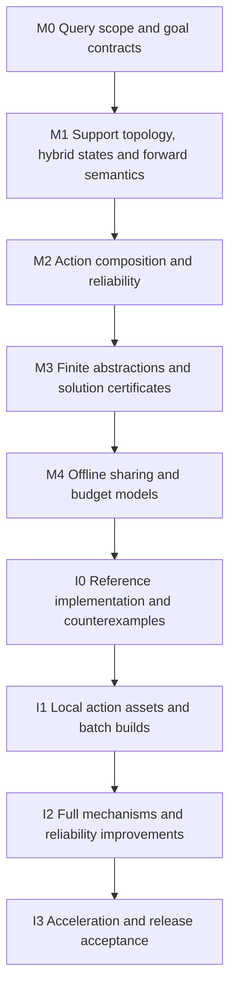

# Ganglia mathematical modeling and local offline progressive-solving roadmap

Version v3, 2026-11-04. The code baseline is Terra-Online/Ganglia 0.1.0-alpha.21, commit
[3a32a5d2f0df355107dcf94f5ed13fd9ae7b69a7](https://github.com/Terra-Online/Ganglia/commit/3a32a5d2f0df355107dcf94f5ed13fd9ae7b69a7).
This document concerns navigation that human players can execute, covering ground movement, jumping
and falling, airborne targets, ziplines, bounce devices, periodic moving platforms, elevators with
selectable floors, and sprint-stamina allocation. The repository baseline has been rechecked. The
120–200-second durations are user reports for some queries. They have not been treated as a measured
average across all queries, and subsecond performance has not been established.

## Current workspace boundary

The [workspace ownership](../README.md#workspace-ownership) changed on 2026-11-08.
References below to a noclip importer describe its role in the data pipeline. The local implementation
is now maintained by Atlos through `talos/integrations/noclip/extractor.patch`; the upstream noclip
checkout stays unchanged. Ganglia algorithms remain in this repository. This ownership migration
does not imply completion of any modeling or performance phase below.

## Decisions in this revision

Implementation status as of 2026-11-07 is tracked separately in
[solver reuse and performance](solver-performance.md). The alpha.21 references below
describe the modeling baseline, not completion of the proposed phases. Ground
passages and device macros have advanced, but G3 regional entry/exit transfers,
cross-query action assets and the full resource-state reference solver remain open.

Local offline computation is the preferred operating mode. The roadmap first defines the
mathematical meaning of tasks, states, actions, reliability and computational budgets, then
establishes reusable offline assets and solving models, and finally selects algorithms and
engineering implementations. Progressive optimization also applies to local builds. A local builder
can first cover more goals, then improve quality, save progress and resume in a later build.

Optimize in-game task-completion time and solver computational resources separately. The former
determines route quality, while the latter determines build cost, update speed and supported scope.
Client-side optimization remains a conditional later option, evaluated only if measured modeling,
offline reuse and local incremental computation still cannot cover an explicitly supported query
family. This revision has no client-side-optimization prerequisite.

The mathematical foundation is hybrid-system planning with resources, device state and task events.
Time abstraction turns actions into directed transitions with conditions and durations. The nominal
discrete model becomes shortest-path search over augmented states. Stochastic execution error can
extend it into a decision model with action durations. Global continuous robust dynamic programming,
a global POMDP and end-to-end reinforcement learning are unnecessary starting requirements. The
immediate need is an inspectable, composable structure that supports progressive refinement.

Ground support and directed passage topology are prerequisites within this model. Level floors,
ramps, curbs and stair flights share a supported-motion contract with explicit controller rules,
clearance and direction. The [ground topology supplement](ground-topology.md) records a generic
staircase false negative in alpha.21, the supplied Atlos case and the G0–G5 implementation gates.
Preserve navigation adjacency separately from detail geometry, diagnose uncertain ground interfaces
and refine them locally before expanding airborne feasibility search. These assets belong in the
same offline sharing and augmented-state architecture.

## 1. Define the questions the offline build must answer

### 1.1 Supported query families

Write a query as

$$
q=(\mathcal S_q,\mathcal G_q,\Theta_q,\mathcal H_q,\mathcal O_q),
$$

Here, $\mathcal S_q$ describes candidate starts, entry costs and initial states. $\mathcal G_q$
specifies task-hit and termination rules. $\Theta_q$ contains versions of character, physics and
device rules. $\mathcal H_q$ describes allowed operations and error models, and $\mathcal O_q$
specifies timing and reliability objectives. A set of 12,000 goals defines query families, without
automatically requiring every goal-to-goal pair. Multiple candidates for one goal are alternative
ways for the solver to access it. They should normally share intermediate search and action
discovery instead of independently solving complete routes from scratch.

Start the first supported scope from existing GroundArrival semantics, making allowed start sets,
availability, initial stamina and capability configurations explicit before expanding parameter
ranges. Routes from fixed teleport entries to all goals, arbitrary ground positions accessing a
regional graph, and queries starting in arbitrary airborne states have different scales. Unspecified
game parameters and product scope should remain explicit model parameters awaiting measurement or a
decision. Assigning favorable defaults silently would change the problem.

The same goal may produce different results with full stamina, low stamina or different platform
phases. The offline system can offer a finite set of explicit configurations or conditional routes
covering state ranges. This choice changes coverage denominators and release size. Finite sampled
success supports claims about those samples. Applicability across an entire continuous domain
requires additional conservative envelopes, error bounds or set-based validation.

### 1.2 Release artifacts and query coverage

A default release artifact may contain complete action sequences, entry requirements, execution
cues, branch conditions and validation levels. Under known static conditions, it can be a complete
route. With unknown platform phase, it may instead be a conditional plan that reaches a safe waiting
area, observes docking and then boards. Such plans can also be generated entirely offline.
Evaluating a condition at runtime is a separate operation from expensive global optimization.

For fixed initial states and a goal-independent transition model, multi-goal queries can share one
or a few state propagations. If candidate generation depends on the current goal, first separate
shared action discovery from goal access, then measure reuse. The current implementation cannot
simply be assumed to replace every query with one ordinary Dijkstra run. Shared prefixes, action
references and parent pointers can compress complete routes, while local action relations serve
multiple starts and goals.

### 1.3 Distinguish three kinds of time

Denote in-game action duration by $\Delta_a$ and route-completion time by $T(\pi)$. Denote device
world time or phase by $\tau$ or $\phi$. Game rules determine their relationship to elapsed journey
time. Known fixed-period platforms can use phase, with any shared synchronization source among
platforms made explicit. Solver computational budget is $b$ or $B$. It belongs to the computation
model and must remain separate from player state and the route's physical duration.

Build budgets should include at least CPU work, wall-clock time and peak memory, adding release size
when needed. Keep per-query stage budgets distinct from whole-batch budgets. Switching to another
arrival must not reset the total computational allowance. Offline tasks can allocate more time to
difficult regions, while saving progress and explaining the additional computation through increased
coverage or improved quality.

## 2. Establish a minimally sufficient hybrid state

### 2.1 State definition and conditions for omitting dimensions

A unified state can be written as

$$
s=(p,v,m,r,\tau,d,z).
$$

$p,v$ denote position and velocity. $m$ describes movement or support modes such as grounded,
airborne, attached to a zipline or riding a platform. $r$ contains stamina, recovery delay and any
necessary counts and cooldowns. $\tau$ is time relevant to the dynamic environment, $d$ is mutable
state of relevant devices, and $z$ is task progress. Retain heading, previous control direction or
sprint activation whenever they affect future behavior or execution cost. Fixed body shape, static
geometry and immutable physical parameters belong to instance configuration $\Theta$, with
references sufficient for search labels.

Minimal sufficiency means that, given the current state, future allowed operations and external
disturbances, future outcomes no longer depend on discarded history. Static scenes can omit time and
device dimensions. A game without airborne dash needs no invented dash counts or cooldowns. Player
heading can be omitted from a purely geometric step when it has no effect. An interface supporting
these states does not require enumeration of their full Cartesian product.

Modes change the interpretation of coordinates and state. On a moving platform, support can be
represented by a platform ID and local position, transformed into world space for collision checks.
Leaving the platform computes exit velocity according to the actual game rules. Equal trajectory
endpoints alone cannot justify merging states that differ in velocity, support, stamina or phase.

### 2.2 Dynamics, guards and resets

Within a mode, use a continuous forward model or a discrete model matching the game, for example

$$
\dot x=f_m(x,u,w;\Theta),\qquad
s^+=R_e(s^-,u;\Theta)
\quad\text{when }g_e(s^-,u;\Theta)=0.
$$

Here, $u$ is an executable control, $w$ is a disturbance, $g_e$ is an event guard, and $R_e$ updates
state for events such as landing, takeoff, resource refresh or device activation. If the game
updates at fixed frames, the model should support discrete stepping and frame-dependent event order.
Replacing that behavior with different continuous physics merely to obtain derivatives would
invalidate its intended semantics. See [LaValle's chapter on hybrid
systems](https://lavalle.pl/planning/node330.html) and [MIT's notes on contact and hybrid trajectory
optimization](https://underactuated.csail.mit.edu/contact.html).

The model specification must fix length, angle and time units, the character-position reference
point, velocity inheritance and reset rules, legal support contacts, and the ordering of
interactions and collisions. Differences between current thin-triangle collision and the game's
solid occupancy also belong in applicability assumptions. Clear equations cannot compensate for
missing geometry coverage. Internal model consistency and accuracy against the real game require
separate acceptance criteria.

### 2.3 Human-executable control sets

Controls need an explicit mapping to actual operations such as holding a direction, jumping,
activating sprint, waiting, interacting, grabbing and releasing. Arbitrary continuous acceleration
curves alone are insufficient. Distinguish fixed input programs from limited-feedback policies
driven by observable events. Feedback assumptions must specify available observations, reaction
delays and input-switching frequency. Policies may use only information available to the player,
excluding future platform motion or unobserved true state.

An initial interpretable skill can align within a region, execute an action and prepare again after
landing. Preparation, turning and settling must consume real time. Treat it as an optional
low-dimensional macro-action, preserving routes with continuous airborne motion and momentum
transfer. Stable supported states then provide compression opportunities without forcing every route
to stop after each landing.

## 3. Define composable action relations

### 3.1 A unified mathematical action interface

An action family should specify its entry domain $I_a$, selectable parameters $\theta$, control
program or policy $\kappa_a$, termination condition and path constraints. Forward execution should
return

$$
F_a(s,\theta,\xi;\Theta)
=
(s',\Delta_a,\gamma_a,\mathcal E_a),
$$

Here, $s'$ is the actual exit state, $\Delta_a$ is duration, $\gamma_a$ is the complete trajectory,
and $\mathcal E_a$ contains events such as target hits, landings, resource changes and device
changes. Failures also need explicit result types, for example collision with a wall, insufficient
resources, a missed boarding window or inability to terminate safely after a hit. Collapsing them
into one empty return loses necessary semantics.

Endpoint-constrained inverse trajectory generation can remain a candidate generator. Forward
execution has a separate responsibility. The generator finds usable parameters, while the validator
computes the actual outcome from a supplied entry and fixed operations or a fixed permitted-feedback
policy. The [options framework](https://www.sciencedirect.com/science/article/pii/S0004370299000521)
of Sutton, Precup and Singh provides a reference for temporally extended action abstractions.
Adopting this structure leaves the choice of reinforcement learning optional.

Store action families separately from their display polylines. Timed polylines support visualization
and playback. Entry conditions, controls, state changes and validation evidence determine
eligibility for planning. Preserve every field's semantics and provenance through import, graph
edges, route segments and final published results.

### 3.2 Composition conditions

In nominal execution, the actual exit of action $a$ must belong to the entry domain of successor
$b$. For an initial-state set $X$ and specified disturbance set, a fixed successor that must work
for every possible outcome requires

$$
\operatorname{Post}_a(X)\subseteq I_b.
$$

A nonempty intersection is insufficient. The existence of one state in region A reaching B, and a
different state in B reaching C, does not establish executability of A→B→C. If successor selection
may depend on an observable exit state, validate coverage by successor entry domains and the
selection rule. Hidden state distinctions cannot be delegated to the player.

This contract underpins sharing and hierarchy in an action library. [Funnel
Libraries](https://arxiv.org/abs/1601.04037) studies related composition through state envelopes
with feedback control and bounded disturbances. Ganglia can adopt the structure before considering a
full polynomial-certification toolchain. Begin with exact nominal states and coherent perturbation
replay, then add conservative entry and exit envelopes selectively for valuable actions. Finite
samples provide a distinct evidence level from a rigorous funnel guarantee.

### 3.3 Static assets, resource transitions and event annotations

Geometric motion, resource transitions and goal events can be stored in separate layers to reuse
spatial motion. Resource labels still determine entry guards, entry velocity can change actual
motion, and goal events require detection along the complete trajectory. Layered storage must
preserve these couplings.

Macro-action compression needs more than a position node and scalar duration per region. Entry
direction, exit velocity, remaining resources and device timing can determine whether the next
segment is executable. Regional interfaces must retain the relevant conditions or multiple
representatives. States that can settle, wait and realign are useful compression boundaries, with
explicit recovery behavior and time costs.

## 4. Express task hits and termination as a state machine

Standing interaction, contact during flight and safe termination after contact use different goal
predicates. For an airborne target, define a trajectory-hit event $H_q(\gamma,t)$ that changes task
state from unhit to hit. If safe completion is also required, the terminal set is

$$
\mathcal G_q=\{s:z=\mathrm{hit}\ \land\ s\in\mathcal S_{\mathrm{terminal},q}\}.
$$

If triggering the target immediately ends the task or teleports the character, define termination
accordingly. A landing requirement would need its own game-rule justification. Safe termination may
allow nonzero velocity, stable support, legal attachment or a state with verified continuation
capability. Report hit time and termination time separately, so grazing a target before an
unrecoverable fall cannot silently receive the same success label as a route that permits continued
action.

Target detection must follow the continuous trajectory or an event-detection procedure with explicit
error bounds. Sample-only checks can miss fast crossings. Contact between an inflated collision
envelope and a pickup volume is insufficient evidence that the actual character triggers
interaction. Actual rules determine interaction volumes, heading and speed requirements. A body
capsule alone cannot stand in for every interaction predicate.

Task state machines can also express stamina restoration after a hit, newly acquired abilities or
prerequisite device use. Add state only for events that actually exist. An arbitrary temporal-logic
solver is unnecessary for the initial version. Retain the existing ground GoalProjector as an
adapter for standing interactions, while allowing airborne destinations their own semantics.

## 5. Objectives, resources and robustness

### 5.1 Primary objective and units

The proposed default minimizes nominal completion time under specified task, resource and
execution-reliability requirements. Write it as

$$
\min_{\pi\in\Pi_{\mathrm{human}}} T_{\mathrm{nom}}(\pi)
\quad
\text{s.t. dynamics, collision, resource, goal and reliability constraints}.
$$

Here, $\Pi_{\mathrm{human}}$ is the set of permitted human input programs or policies defined
earlier. Store physical time, execution-difficulty proxies and validation evidence separately.
Penalties used for search ranking have a separate meaning from ETA. Before optimizing expected
completion time or severe-failure tail costs, define recovery, retry or termination losses.
Otherwise completion time may be undefined for failed trajectories.

Making full use of stamina means resource scheduling toward actual time optimality, with no
independent reward for consumption. Stamina may guard actions, drain or recover over time, and
depend on recovery delay and mode. Task semantics determine final resource requirements. Clarify the
existing reserve parameter's business meaning, distinguishing a sprint-stop threshold, a route-wide
hard constraint and a terminal reserve.

### 5.2 Three evidence semantics

Nominal feasibility establishes success for a given state, control and model. Set-based robustness
requires one allowed policy to succeed for every disturbance in the specified range, with quantifier
order $\exists\pi\,\forall\xi$. Re-solving a different perfect action for each disturbed scenario
would answer another question. Probabilistic reliability requires
$\Pr(\mathrm{success})\ge1-\epsilon$ under an explicit distribution $\mathsf P_\xi$, keeping the
true probability requirement distinct from finite-sample confidence evidence.

These three levels can be implemented progressively. First ensure correct nominal propagation and
composition, then coherent perturbation evaluation, then selective set envelopes or stronger
certification for critical actions. Empirical tests should report distribution, sample count,
statistical method and applicability domain. Separate tuning samples from final evaluation. Adaptive
repeated acceptance testing also requires corrections beyond unadjusted fixed-sample confidence
conclusions.

A gravity or input-direction bias may persist throughout a route. Re-sampling an unrelated world at
every segment would lose that structure. A per-segment worst-case model that allows arbitrarily
changing disturbances may be more conservative than a fixed unknown-parameter model. State the
approximation explicitly. The initial version can retain necessary persistent-error parameters, or
use conservative sets and whole-route replay, before considering a global belief space.

### 5.3 Make path-family width comparable

For a fixed action family, corridor and permitted feedback rules, define a bounded, normalized
entry-and-control disturbance neighborhood $\Xi_0$ that contains zero and is star-shaped. Boxes or
ellipsoids usually provide nested scaled sets. Define the following tolerance scale only for
policies whose nominal execution succeeds, and mark nominal failure separately.

$$
\rho(\pi)
=
\sup\{r\ge0:
\mathrm{Success}(\pi,s_0,\xi)\text{ holds for all }\xi\in r\Xi_0\}.
$$

Normalize dimensions of $\Xi_0$ by meaningful position, heading, timing and velocity error scales.
Mixing raw meters, degrees and seconds directly is invalid. The definition focuses on the narrowest
failure direction and can be combined with probability-weighted successful-domain volume. Describe
different branches or disconnected successful domains separately. Label empirical estimates as
estimates. Rigorous lower bounds require conservative validation. Finite all-success samples cannot
establish the universal proposition above.

Generating many similar curves leaves the successful domain unchanged, and a convex hull may cross
failure holes. Perturbations that consistently fall into the same location can have low endpoint
variance. Different safe landings on a wide platform can have high variance. Whole-task success,
continuation compatibility and failure consequences remain primary, with trajectory spread and
endpoint variance used as auxiliary statistics.

### 5.4 Risk composition

Edge success rates independently measured from ideal entries cannot simply be multiplied into
whole-route success probability. The actual exit distribution of the previous action, persistent
input bias and device-phase errors affect the next action. Conditional probabilities must correspond
to those entry conditions. Per-segment risk budgets require proof of validity over their declared
entry ranges and histories, followed by an appropriate union bound or other composition rule.

Scalar risk accumulation is generally insufficient to express all correlations. Initially, execution
margins can proxy candidate ordering, with coherent whole-route perturbation replay providing final
empirical evaluation. Strict probabilistic-constrained solving requires an augmented state and
risk-propagation model matching the uncertainty assumptions. Bellman-optimality claims require that
defined model.

## 6. Establish the solving model before choosing a search algorithm

### 6.1 Nominal Bellman equation

Given deterministic action transitions $T_a(s)$, legal entry sets and complete goal states, the
nominal value function satisfies

$$
V(s)=
\inf_{a:s\in I_a}
\left[
\Delta_a(s)+V(T_a(s))
\right],
\qquad
V(s)=0\quad(s\in\mathcal G_q).
$$

When an action includes continuous control choices, treat those parameters as part of the action.
Actions violating path collision, resource or task conditions are excluded from the feasible set.
The value is infinite when no feasible completion policy exists. Specify a finite task horizon or
other conditions ensuring proper termination, and prevent infinite zero-time event loops. Indefinite
waiting or a nonterminating skill must never count as success.

On a finite, deterministic augmented state graph, this is a shortest-path problem. Dynamic
programming and heuristic search are compatible. The Bellman principle defines the optimal
structure, while Dijkstra, A* and related algorithms determine how to compute it selectively.
Actions with durations and stochastic exits can also admit expected-value recurrences, provided
state sufficiency, feedback information and objectives satisfy the chosen model's assumptions.

### 6.2 Multiple labels and safe dominance

Each spatial interface may retain multiple arrival labels containing accumulated cost and state that
changes continuation capabilities. The fundamental deletion criterion is continuation
substitutability. Every feasible continuation of a removed label must be reproducible from a
retained label at no greater total cost. More resources, shorter cooldowns and less elapsed time are
sufficient only when other dynamics, device and task conditions are compatible and resource rules
are monotone.

Different velocities, inability to wait in the air and different dynamic-platform phases can
invalidate simple dominance. Earlier arrival may dominate later arrival only when legal waiting can
reproduce the later state without degradation. Resources, risk and device state must also progress
during that wait. Nearby positions in a coarse grid do not establish continuation equivalence
either. Retain multiple representatives or state the approximation loss when necessary.

Fixed label caps, beam truncation and candidate pruning can enforce engineering budgets, with
explicit reporting of which guarantees they change. Compare complete solutions against pruned
results on small exhaustively solvable models before adding complex heuristics. Tests detect
implementation errors, while dominance itself requires a modeling argument. [Boost's RCSP
documentation](https://www.boost.org/doc/libs/latest/libs/graph/doc/html/graph/algorithms/shortest_paths/r_c_shortest_paths.html)
illustrates resource extension and dominance defined by the problem model.

### 6.3 Two abstractions with different responsibilities

Optimistic abstractions relax constraints while retaining an optimistic representation of every
genuinely possible completion. They support reachability upper bounds or time lower bounds. Verified
concrete actions or conservative action domains provide actual feasible routes and cost upper
bounds. Ordinary position bucketing or velocity-sampled graphs acquire neither property
automatically.

Solving the currently verified action graph optimally establishes optimality within that candidate
model. A lower bound for the full continuous game problem requires additional justification.
Removing platforms and their opportunities for landing or resource refresh can make a supposedly
simplified problem harder. Ground-only movement that omits ziplines can also overestimate shortest
time. An abstraction intended to lower-bound the full problem needs an explicit mapping argument
from every feasible original trajectory to a relaxed path of no greater cost.

Prioritize resolution refinement where feasibility is narrow, action composition fails or quality
gaps are large. Interpolated trajectories, neighboring velocity bins and phase-interval center
samples still need validation, especially near collisions, landings, resource thresholds and
missed-service boundaries. Without error bounds, treat them as candidate-generation methods and
leave uncovered ranges unknown.

## 7. Organize offline precomputation into shared mathematical assets

Core offline assets are regional interfaces, action families and entry/exit relations, connected to
goal-access predicates and concrete query results. Complete-route caches can remain, with references
to shared actions, applicable states and evidence. This supports both batch generation of full
routes from fixed starts and publication of a small number of branches or parameterized results for
conditional configurations.

Separate build caches from published artifacts. Heavy collision indices, search frontiers, failed
samples and most intermediate candidates can remain local for later builds. For an explicit finite
query family, solve complete routes locally and publish a compact route index, shared action
references, applicability conditions and necessary evidence. Clients can then perform lookup,
conditional selection and display without a global optimizer.

Regional decomposition limits local geometry work and shares connections. Edge construction must
preserve cross-floor relationships, body support, action direction and long-distance device
connections beyond three-dimensional Euclidean proximity.
[HPA*](https://citeseerx.ist.psu.edu/document?doi=b0f0432ba69e4d730b93a75e3d19c8e9d811efac) offers
organizational ideas through partitioning and cached local crossings. Local problems carrying
resources and velocity require richer interfaces than a single scalar distance.

Each asset stores its applicability domain and dependencies, including geometry and collision
chunks, body shape, physics and control models, resource rules, device semantics, validation
tolerances, and any required entry-velocity or phase ranges. Intermediate space traversed by the
trajectory is also a dependency. Endpoint chunks alone are insufficient. Current within-call caches
can reasonably depend on a fixed snapshot. Cross-version caches require these implicit conditions to
become explicit.

Invalidate feasibility and optimality separately. A faster new action usually preserves an old
route's feasibility while potentially invalidating its optimality claim and distance bounds based on
an incomplete graph. Changing risk preferences can preserve raw trajectory evidence while requiring
reranking. Geometry, body-shape or dynamics changes may directly invalidate affected actions and
should trigger dependency-based revalidation.

Cached failures also need scope. Exhaustion of a finite action graph, conservative failure
certification within a parameter domain, failure of one sample and budget exhaustion are four
distinct evidence classes. Release manifests must retain these distinctions. Interrupted builds
should save verified actions and unfinished work, keeping a previous unsuccessful search from
becoming a permanent unreachability claim.

## 8. Include computational budgets and progressive optimization in the model

### 8.1 Deliverable state of one query

Let $\mathcal F_q(b)$ denote candidates that have met the selected validation requirements within
computational budget $b$. The current deliverable upper bound is

$$
U_q(b)=\min_{\pi\in\mathcal F_q(b)}T(\pi),
$$

Use infinity for an empty set. With a valid optimistic model and fully accounted search frontier,
also maintain $L_q(b)$ and state

$$
L_q(b)\le T_q^\star\le U_q(b).
$$

The meaning of $T_q^\star$ must identify the action set, abstraction resolution and reliability
requirements defining the optimum. A nominally feasible route is insufficient as a feasible upper
bound for a strictly robust problem. Statistical reliability evidence also differs from a
deterministic robustness certificate. An $U_q$ obtained only from empirical acceptance is, at most,
an upper bound for the defined empirical-acceptance problem. Applying it to a true
chance-constrained problem requires separate confidence guarantees that the selected route meets the
probability threshold, accounting for candidate selection and repeated testing. Report no optimality
gap when no valid lower bound exists. Several rounds without improvement cannot replace one.

Implicit on-demand edge generation can preserve search guarantees if successor generation is
complete and unfinished edge-generation and refinement tasks remain accounted for on the frontier.
Candidate truncation, label deletion or changed risk objectives require guarantees to be rechecked.
[ARA*](https://papers.neurips.cc/paper_files/paper/2003/file/ee8fe9093fbbb687bef15a38facc44d2-Paper.pdf)
is a possible later anytime solver. Its name alone cannot establish a mathematical contract before
its assumptions are satisfied.

Results should separately describe route existence, validation level, stopping reason and remaining
unknown scope. Timeouts, cancellation, unsupported goal semantics, mapping failures and exhaustion
of a finite model need distinct states. Confirmed results can accumulate under fixed model and
validation rules. When counterexamples or model upgrades invalidate old evidence, revoke the
incorrect conclusion. A monotone improvement curve must not be maintained by displaying invalid
routes.

### 8.2 Batch-build objectives

Offline builds introduce a second graph. Physical-action graph nodes are game states.
Computation-task dependency graph nodes are candidate generation, action validation,
parameter-domain refinement and route improvement. One action-validation result may help many goals.
Budget allocation should therefore target reusable work, with its sharing relationships explicitly
represented in the build model, beyond merely running the same large function for each of 12,000
goals.

For a fixed evaluation query set $\mathcal Q$, define verified-route coverage under budget $B$ as

$$
C_{\mathrm{feas}}(B)
=
\frac{\sum_{q\in\mathcal Q}w_q
\mathbf 1[\mathcal F_q(B)\ne\varnothing]}
{\sum_{q\in\mathcal Q}w_q}.
$$

Separately record coverage meeting recommendation-reliability requirements $C_{\mathrm{rec}}(B)$,
the proportion proven unsolvable within the declared model, the unknown proportion, and the
proportion with valid quality bounds. Product importance may define weights. Without a visitation
distribution, begin with equal weighting and scene-stratified statistics. Continuous-domain coverage
and finite-test-set coverage need distinct claims. Preserve physically unreachable targets in the
declared denominator instead of silently removing them to improve the numbers.

The proposed budget policy first increases feasible coverage within the specified scope, then meets
reliability thresholds, then improves duration and quality gaps of reliable routes. Difficult
queries deserve a fair minimum exploration opportunity, and shared bottlenecks deserve additional
budget. Prevent one target from consuming an unlimited fraction of the build. Estimated coverage or
quality gain per unit computation can guide scheduling as an engineering heuristic. An optimal
metaplanning claim would require separate evidence.

### 8.3 Stopping and release conditions

Release thresholds jointly depend on supported scope, feasible coverage, reliability evidence, total
CPU time, wall-clock time, peak memory and artifact size. Fast first solutions do not establish
cheap batch builds, and high throughput does not establish timely completion of difficult individual
queries. Report both. At local budget exhaustion, publish results meeting the required level
together with manifests of conditional support, unknowns and unsupported cases.

Continued computation should reuse progress. Resumable units include action-family sampling
progress, verified controls, local graphs, necessary search frontiers and current best routes.
Choose persistence frequency by cost, without writing every small step. Local updates should
recompute only affected assets and dependent queries, bringing later release costs closer to
incremental costs.

Subsecond first solutions are a later measurement target, with no role as an axiom of the current
mathematical model. A local offline task can allocate seconds, tens of seconds or longer to
difficult queries according to total budgets and expected gains. After model and reuse validation,
measurements can determine whether client-side supplemental computation is necessary.

## 9. Model-first development phases

### M0 Task contracts and query families

Deliver a task specification fixing goal types, hit and termination semantics, candidate starts,
capability configurations, initial resources, dynamic-environment information and permitted output
forms. The first query family should represent static ground, jump-required routes, airborne hits,
device access and dynamic devices, without exhaustively enumerating every continuous configuration.
Define game time, device phase and computation time separately.

Acceptance requires every representative input to be classified as supported, conditionally
supported or currently unsupported. A failed ground projection must preserve the airborne goal's
unresolved reachability. Unknown platform phase must remain unknown instead of becoming the most
favorable phase. A* weights, ant-colony parameters and Worker counts are decisions for later stages.

### M1 Hybrid states and forward semantics

Deliver specifications for state fields, controls, mode dynamics, event guards, resets, resource
evolution and legal contacts. Ordinary movement includes layered support identity and directed
passages for slopes, curbs and stair risers. Define its ground-controller stepping semantics,
headroom and sweep constraints under the ground topology supplement, then use the same framework to
identify additional state for ziplines, bounce devices, periodic platforms and controllable
elevators. Complex mechanisms may remain unimplemented, but their transition semantics must be
explicit before they become isolated special edges.

Acceptance focuses on Markov sufficiency and unit consistency. Construct examples with the same
landing position but different velocities, equal stamina but different recovery delays, and equal
positions but different platform phases. Check whether their feasible continuation sets really
differ. Mark physical parameters lacking game-data confirmation as assumptions. Formal structure
alone cannot establish physical accuracy.

### M2 Composable actions and reliability contracts

Deliver action entries, control programs or limited-feedback policies, durations, exit relations,
events and evidence structures. Define composition through nominal state continuity, set containment
or coverage by conditional branches, then define reliability thresholds for recommendations. Fix
path-family width, error scales and whole-route success predicates at this stage, so algorithms
optimize a relevant quantity from the beginning.

Acceptance must distinguish $\exists\pi\,\forall\xi$ from choosing actions anew after perturbation.
Composition rules must reject counterexamples where two jumps are individually reliable but their
exit and entry states are incompatible. Distinctions among sampled evidence, conservative-domain
evidence and real-player calibration must persist through result formats.

### M3 Finite abstractions, Bellman structure and certificates

Deliver a finite reference model defining action boundaries, state resolution, action
parameterization, waiting and time windows, dominance, and search-truncation semantics. Design an
optimistic lower-bound model separately from the verified action set providing upper bounds. An
ordinary sampled graph cannot be assumed to serve both roles. State whether claims concern
optimality within the finite model or include additional error guarantees extending to the
continuous model.

Use small scenes with manually checkable or exhaustively enumerable reference solutions. Verify
preservation of slower resource-saving routes, separation of same-position states with different
velocities, and accounting of unknown-edge tasks in quality bounds. Mathematical arguments determine
safe pruning, then tests check implementation adherence. The simplest complete solver is sufficient
as a reference at this stage, before production performance becomes the objective.

### M4 Offline sharing structures and budget models

Deliver dependency graphs for reusable assets, cache applicability domains, sharing relationships
among query families, and coverage/quality metrics over total budgets. Design multi-goal reuse for
fixed starts, parameterized or conditional routes for device conditions, and invalidation
propagation for local updates. Define resumable-task boundaries and distinguish route feasibility,
reliability evidence and optimality claims.

Acceptance requires one local action to serve multiple goals, local geometry edits to trigger scoped
rebuilding, and faster new actions to revoke outdated quality claims correctly. Resuming after
budget exhaustion must reuse existing assets while preserving unknown states as unknown. M0–M4
together provide a sufficiently explicit basis for comparing algorithms and deployment choices.

### I0 Minimal reference implementation

First establish the directed ground-only reference with the supplement's G0–G2 gates, including
multi-riser stairs, overlapping supports, tile seams and blocked-passage controls. Compare native
build topology, exported topology and reconstructed motion to locate connectivity loss. Then
implement jumping, falling, resource recovery and complete state continuity, retaining the existing
analytic generator and collision capabilities. Replay candidates through an independent forward
validator, passing actual exits into subsequent actions and
preserving evidence throughout the pipeline. Use an inspectable complete baseline search for the
resource-augmented graph. Correctness should be established before relying on complex heuristics.

Acceptance must include the reproduced synthetic counterexample where an ordinary connection
provides a 6-second feasible route and adding a faster resource-infeasible connection must preserve
that feasible solution. Also verify propagation from perturbed entries without re-solving for the
same endpoint, goal-event detection beyond the final point, and recovery of verified results after
interruption. These tests establish algorithm behavior. Real game replay separately calibrates the
physical model.

### I1 Local offline assets and batch builds

Compile layered support regions, validated ground passages, local directed action families, goal
access, resource transitions and evidence into assets supporting regional loading and incremental
updates. Reuse known entries and actions across goals, retaining meaningful alternatives in duration,
resource demand and execution
margin within each family. Measure representative regions and progressively larger query sets before
deciding to begin the full 12,000-goal build.

Acceptance includes cache reuse, first-solution coverage curves, total computational cost, peak
memory and release size. Compare clean builds explicitly against incremental builds after local
edits. Warm-cache query speed alone is insufficient. Cache keys valid within one call need
cross-version applicability conditions, and failed samples remain valid only under their original
conditions.

### I2 Full mechanisms and reliability improvements

The suggested mechanism order is static ziplines and bounce devices, airborne hits with safe
completion, docked platforms with known phase, conditional navigation with unknown phase, transfers
in motion, and controllable selectable-floor elevators. Each mechanism shares the established
transition interface, progressing resources during waiting, interaction and riding. Refine ground
sprint decisions around resource thresholds, turns and time windows. Add dash separately only after
its actual rules are confirmed.

Progress reliability from cheap execution-window and clearance metrics to whole-route perturbation
replay, then consider set envelopes for high-value actions. Validate current difficult executions
and cross-action error accumulation before seeking limiting continuous-parameter times. Admit a
whole route to a recommendation class only after it meets that class's threshold. Independent
success of each segment is insufficient.

### I3 Acceleration, local optimization and release acceptance

Use component timings to choose among lazy validation, incremental graph updates, admissible
heuristics, ARA*, improved spatial indices or hot-loop optimization. CEM, finite differences and
differentiable methods are options for local parameter optimization, all consuming defined actions
and forward models and ending in independent revalidation. An algorithm counts as an improvement
only when it increases coverage or quality under the same tasks, evidence requirements and
computational budgets.

Release acceptance first checks whether the local approach meets agreed budgets. If it does,
client-side optimization is unnecessary. If it does not, identify model coverage, parameter
dimensionality, insufficient sharing or actual compute limits before comparing a narrower initial
configuration, higher local throughput, on-demand local builds and client-side supplemental
computation. Remaining gaps and measured costs must justify any client-side path.

## 10. Roles of specific algorithms in the revised roadmap

Multi-label Dijkstra is a baseline candidate for the finite reference model. A*, Weighted A* and
ARA* become acceleration candidates after the state and reliable lower bounds are established. Lazy
edge validation suits expensive exact collision checks or forward propagation, with re-search costs
included in evaluation. See [Generalized Lazy Search](https://arxiv.org/abs/1904.02795).
[ALT](https://www.microsoft.com/en-us/research/publication/computing-the-shortest-path-a-search-meets-graph-theory/)
provides a reference for landmark heuristics, whose caches must correspond to valid relaxations
containing the necessary shortcut actions.

Differentiability primarily supports local action-parameter adjustment and sensitivity analysis. It
is optional for bounded-time computation. With fixed or locally stable event structure, optimize
takeoff position, direction, sprint timing and execution margin. Derivatives across events may
require special treatment, as discussed in [Saltation Matrices](https://arxiv.org/abs/2306.06862)
and [hybrid iLQR](https://arxiv.org/abs/2103.14584). Differentiating an endpoint-constrained inverse
generator measures its re-aiming behavior and cannot establish stability of fixed player execution.

CEM can provide a local-optimization baseline for low-dimensional nonsmooth action parameters.
Evaluate gradient methods when a credible differentiable propagator and constraint approximations
exist. Both should retain distinct corridors and action families to avoid collapse onto one narrow,
fast mode. After surrogate-constraint optimization, revalidate with the original forward and
collision models. A smooth collision loss has a separate role from final legality checks.

ACO is deferred as a main searcher because state, action semantics, composition and evidence gaps
require independent solutions. Artificial pheromone levels cannot establish ease of human execution.
Once models and data stabilize, reinforcement learning may rank candidates, allocate computational
budgets or supply restricted local skills, with comparisons against non-learning baselines under
equal budgets. The high-frequency corrections available to MPPI or automated controllers require
separate restrictions before they can represent player-followable navigation.

Game-engine region corridors, special-action connections and execution callbacks offer
interface-design references. Experience from Recast/Detour, Unity NavMeshLink and Unreal Smart Link
still requires additional mathematical modeling for stamina, dynamic devices and human reliability.
Existing Ganglia surfaces, portals, support checks, capsule sweeps, analytic jumps and authored
rope/launch connections are reusable assets. Refactoring should connect them through semantics and
evidence while retaining their established capabilities.

## 11. Acceptance benchmarks and local-deployment decisions

Benchmarks should cover spatial, resource, temporal and human-execution failures. Spatial cases
include narrow takeoff regions, low ceilings, diagonal landings, diverse landings on wide platforms
and different exit velocities. Resource cases include two jumps competing for sprint, recovery
delay, actions enabled by waiting and goals permitting no stamina reserve. Temporal cases include
missed platform windows, ride clearance, conditional navigation under unknown phase and floor
selection changing an elevator's future. Task cases include ascending hits, fast crossings of small
volumes, unsafe completion after a hit and ability changes triggered by a goal.

For each class, begin with interpretable synthetic scenes to isolate mathematical and implementation
problems, then calibrate physics and execution errors using real game scenes. A route may feel
difficult because of unclear trigger cues, control switching or input mapping, beyond small
geometric clearance. Final output should explain critical takeoff regions, entry conditions and
execution windows, keeping mathematical scores aligned with practical guidance.

Performance reports should include cold and warm time to first nominal solution, time to first
recommendation-qualified result, and coverage/quality curves under fixed total budgets. Full builds
record total CPU work, wall-clock time, memory and artifact size. Incremental builds record
affected-asset counts and recomputation ratios. Preserve timeouts and unsupported queries in the
statistics. Use 120–200-second slow cases to locate bottlenecks, with representative sampling
required before estimating an all-goal mean.

The next concrete deliverable should be a small, checkable hybrid-state model with
action-composition examples and reference solutions, together with a fixed first offline query
family. Then compile those models into locally shared assets and use coverage curves to choose
sampling precision and algorithms. The need for client-side optimization becomes a deployment
decision based on measured local results.

## Appendix A. Migration evidence from the current implementation

The following retains the main code facts checked in the previous version as a mapping between the
model and existing assets. It identifies interface boundaries without assuming every mechanism is
absent or inferring the full cost breakdown of a real slow query from code structure alone. Use
these facts when changing implementation and component timings when validating bottlenecks.

### Trajectory generation and execution-error replay remain coupled

[`jumpConnection`](https://github.com/Terra-Online/Ganglia/blob/3a32a5d2f0df355107dcf94f5ed13fd9ae7b69a7/src/jumps.ts)
constructs a horizontal trajectory from specified endpoints and the vertical-motion duration, using
the specified `end` for the final sample.
[`sampleJourney`](https://github.com/Terra-Online/Ganglia/blob/3a32a5d2f0df355107dcf94f5ed13fd9ae7b69a7/src/motion.ts)
interpolates existing points and times for playback. Forward physical propagation from control
inputs requires a separate interface. Calling `jumpConnection(start', end)` after perturbing the
start readjusts the action for that start, so this procedure cannot measure the tolerance of a fixed
execution.

In obstacle-free diagnostic calls, starts at `[0,0,0]`, `[0.2,0,0]` and `[0,0,0.2]` all produced
trajectories ending exactly at the same target `[5,0,0]`, with intermediate motion also changing
with the start. This confirms that the generator re-aims. It provides no evidence that actual
perturbed executions share a landing point. The existing generator remains suitable for nominal
candidates, provided that candidates expose action parameters that can be saved and replayed.

### Retention currently favors witnesses that a connection exists

Region-pair validation in
[`traversal.mjs`](https://github.com/Terra-Online/Ganglia/blob/3a32a5d2f0df355107dcf94f5ed13fd9ae7b69a7/src/traversal.ts)
returns when it finds a feasible arc, and validated region pairs receive no further systematic
comparison of other actions.
[`shortcuts.mjs`](https://github.com/Terra-Online/Ganglia/blob/3a32a5d2f0df355107dcf94f5ed13fd9ae7b69a7/src/shortcuts.ts)
also uses the spatial cells of the start and end as an acceptance key. Once one action succeeds, it
skips other candidates for that cell pair. Existing diversity budgets help discover connections, but
are insufficient to estimate the successful domain around one execution.

These mechanisms alone do not establish the cause of any particular difficult result. They do show
that later evaluation may never see more forgiving candidates. Retention needs to consider
movement-mode sequences, entry states, takeoff and landing regions, and corridor topology together,
preserving representatives with different speed and execution-margin tradeoffs. Repeated sampling of
the same small successful region must not improve its robustness rating.

### The current objective accepts only faster routes

`shortcuts.mjs` bounds candidates by the baseline's actual travel time and prunes a candidate when
its time lower bound cannot improve that value.
[`planJumpRoute`](https://github.com/Terra-Online/Ganglia/blob/3a32a5d2f0df355107dcf94f5ed13fd9ae7b69a7/src/jump-planner.ts)
also updates the incumbent only for a complete result with shorter actual duration. Adding a
difficulty score only to the final result would therefore miss slightly slower, more forgiving
routes already excluded during generation.

Generation budgets, candidate retention, pruning and final comparison need coordinated changes. The
default recommendation may use an explicit additional-time budget relative to a currently known
feasible route. The unknown continuous global optimum provides no justified reference for that
budget. Maintain separate incumbents for robustness-qualified routes and nominally fastest routes.
The nominal incumbent is an invalid feasible upper bound for a search whose required feasible set
includes robustness constraints.

### Resource scheduling and route selection remain separate

[`routes.mjs`](https://github.com/Terra-Online/Ganglia/blob/3a32a5d2f0df355107dcf94f5ed13fd9ae7b69a7/src/routes.ts)
retains the lowest static cost per node, and
[`ground.mjs`](https://github.com/Terra-Online/Ganglia/blob/3a32a5d2f0df355107dcf94f5ed13fd9ae7b69a7/src/ground.ts)
invokes resource scheduling after selecting a route. In an earlier synthetic check, an ordinary jump
produced a feasible route lasting 6 seconds. Adding a faster connection whose sprint-entry condition
was unsatisfiable made the ground planner return `no-verified-route`. This demonstrates the need to
retain feasible alternatives within resource-state search, instead of filtering selected results
only at the end.

[`retimeGroundRoute`](https://github.com/Terra-Online/Ganglia/blob/3a32a5d2f0df355107dcf94f5ed13fd9ae7b69a7/src/locomotion.ts)
already retains labels for stamina, recovery delay, gait, velocity and direction. Its
resource-transition ideas are reusable. Its main decision, however, is whether each continuous
ground run permits automatic sprinting. Arbitrary activation, stopping and waiting policies remain
outside its coverage. The current `sprint` refers to ground sprinting. Airborne dash counts,
cooldowns and velocity changes require separate rules.

### Special actions already have a basic representation

[`GroundConnection` and
`MovementMode`](https://github.com/Terra-Online/Ganglia/blob/3a32a5d2f0df355107dcf94f5ed13fd9ae7b69a7/src/index-types.ts)
already support explicit `rope` and `launch` connections with direction, trajectories and timing.
Complete zipline or bounce-device import and control semantics still require additional work.
Current high-level connections require ground-projected endpoints, use fixed world-space
trajectories, and express time relative to segment entry. Missing semantics include interaction
regions, entry and exit conditions, device states, exit velocity and dynamic support.

[`createGoalProjector`](https://github.com/Terra-Online/Ganglia/blob/3a32a5d2f0df355107dcf94f5ed13fd9ae7b69a7/src/goals.ts)
still returns ground standing points for interaction goals. Passing through an airborne pickup
volume, continuing to land after a hit, and leaving a bounce device in an airborne state require
separate event and task states. The current prepared planner assumes an immutable scene snapshot.
Moving-platform phase and elevator control introduce world-state changes beyond that assumption.

### Additional checks of entry state, evidence propagation and budgets

Current Node and GroundArrival primarily represent position and entry cost. GroundConnection and
Segment primarily represent timed polylines and requiredGait. Complete entry/exit velocity,
execution controls and device state need additional semantics. InteractionGoal's facing defines the
goal's forward cone, with player orientation requiring a distinct representation. Introduce these
meanings explicitly in the new model. Similar field names cannot establish equivalent capabilities.

The motionValidation field returned by jumpConnection is incompletely propagated when ground import
rebuilds graph edges and routeSegment reconstructs segment objects. Validation provenance, model
version, applicability domain and error tolerances should form an evidence structure carried
throughout the pipeline. Preserve the distinction between authored declarations and independent
forward validation. A display polyline passing format checks provides no automatic validation of
actual in-game actions.

After finding its first feasible route, planJumpRoute may continue shortcut search and consider
other arrivals. maxCandidates resets within each arrival, and the current interface lacks a
request-wide wall-clock deadline or cancellation mechanism. Ground endpoint connections may be
repeatedly assembled into dense relationships as actions are added, with caches removing only some
of that work. Offline-build changes should preserve intermediate feasible solutions and validated
assets, and first measure the gap between first-solution time and final-return time.

## Appendix B. Detailed modeling of individual mechanisms

These mechanism descriptions retain the previous version's physical and task boundaries, now
connected to the unified state and action contracts. They can be implemented incrementally, enabling
only the state dimensions needed by each query. The phases above and measured coverage gaps
determine implementation order.

### Airborne destinations

The goal interface should distinguish standing ground interaction, trajectory contact, and safe
termination after contact. Airborne targets require continuous trajectory-intersection events with
the pickup volume, including ascending motion and fast crossings. Checking trajectory samples or
landing positions alone is insufficient. If safe landing is required after a hit, carry `goalHit`
through continued search. If collection changes resources or movement capabilities, represent that
change as an event transition.

Airborne states must retain actual velocity, movement mode and resources as well as position. Device
launches, mid-zipline releases and jumps from moving platforms can all feed the same airborne
propagator. The query interface should explicitly state whether airborne initial states are allowed.
Automatically projecting them to ground would change the original problem.

### Static ziplines and bounce devices

For static ziplines, first implement the complete approach, grab, ride and exit sequence. Add entry
volumes, heading or interaction requirements, startup overhead, availability and exit velocity.
Fixed-endpoint versions can reuse existing `rope` connections before dynamic platforms are
available. Mid-ride release requires an attached state and release event, with actual exit velocity
passed to the airborne propagator. Editing the endpoint of a fixed polyline alone is insufficient.

Bounce devices should supply a launch initial state, including initial velocity, entry-velocity
inheritance, permitted air control and resource-reset behavior. Their rules may differ from ordinary
character jumps and require an explicitly chosen model beyond a shared `maxJumpHeight`. A fixed
trajectory through complete landing can first enter as a `launch` macro-action. Continuous airborne
decisions after launch must also allow an airborne output state.

### Platforms following fixed back-and-forth paths

Platforms should expose time-dependent poses, standing regions, docking and boarding windows, and
stable device IDs. Once boarded, express character position in platform-local coordinates and
transform it into world space at the current time. A moving platform provides support and also
constitutes dynamic collision geometry. Boarding, riding and departure require relative-velocity,
full-body-clearance and legal-contact checks. Velocity inheritance at takeoff must follow the game's
rules.

The first version should prioritize boarding and departure at stops and safe waiting, then extend to
boarding or jumping off in motion and transfers between platforms. Reuse the static-terrain BVH
while giving dynamic objects separate time-dependent queries and continuous-motion bounds.
Rebuilding the entire NavMesh every frame is unnecessary. Endpoint-only checks cannot establish
clearance from ceilings or obstacles throughout a ride.

For known phase, an edge's cost includes waiting after arrival, boarding, riding and exiting, with
resource progression in every stage. FIFO in time-dependent shortest paths requires the arrival-time
function to be nondecreasing in departure time. A fixed platform period alone does not establish
this property. If waiting is freely available at a safe point and cannot affect the device's future
motion, choosing an appropriate later service can form a waiting envelope. Resources and velocity
may still require multiple labels. See [Dean's paper on FIFO time-dependent
networks](https://people.csail.mit.edu/bdean/tdsp.pdf).

[SIPP](https://www.cs.cmu.edu/~maxim/files/sipp_icra11.pdf) offers safe intervals to compress time,
initially useful for states that can settle and wait. Original SIPP depends on assumptions such as
instantaneous stopping. Direct use with acceleration or deceleration constraints may be incomplete,
as discussed in [SIPP-IP](https://arxiv.org/abs/2302.00776). Airborne motion and transfers with
entry velocity still require their corresponding dynamic states. Safe intervals alone cannot replace
them.

If OEM lacks synchronized game time or platform phase, the default output should use conditional
steps such as boarding after the platform docks, with waiting ranges derived from known operating
rules. Expected waiting time requires a specified phase distribution. Neither half-period waiting
nor a platform already at the stop is a justified default. Refine the plan into a timed trajectory
after receiving reliable phase information, and evaluate whether arrival-time errors can make the
player miss a window.

### Elevators with selectable floors

Calling an elevator and selecting a floor alter its future. Model a small device state machine
containing its current floor or movement phase, door state, destination floor and relevant
permissions. Character actions include calling, waiting, entering, selecting a floor, riding and
exiting. Device-state changes belong to the joint search state. Compress the full process into a
conditional macro-action only when other requests are known to be absent and behavior is
predictable.

Keep the exogenous time process of periodic platforms distinct from controllable elevator
transitions. With incomplete information, such as other players' requests or an unobserved elevator
location, output conditional actions or conservative waiting ranges instead of unsupported precise
ETAs. Bound the combinatorial state by expanding only devices relevant to the candidate route, and
state the single-player or known-request assumptions explicitly.

### Making full use of sprint stamina

Optimize completion time subject to execution-reliability requirements. Resource consumption has no
separate reward. If the goal permits zero remaining stamina, an artificial reserve is unnecessary.
Constraints must still account for resources needed by the next jump, boarding action or failure
recovery. In particular, use unavoidable rides, interactions and waits for recovery, comparing the
full consequences of catching the current platform service against moving more slowly to recover
before the next one.

Define resource transitions by action mode. A single `recoveryDuringNonWalk` boolean is insufficient
as a long-term model for every situation. Gradually refine activation, stopping and recovery within
continuous ground runs. Initially generate decisions at events such as stamina thresholds, the end
of recovery delay, turns, device entrances and time windows, adding finer continuous-time decisions
as needed. Event-based decisions require their own completeness analysis. Retain diagnostics for
finite waiting and execution windows, while avoiding large collections of per-frame waiting states
or pointless activation-stop oscillation.
