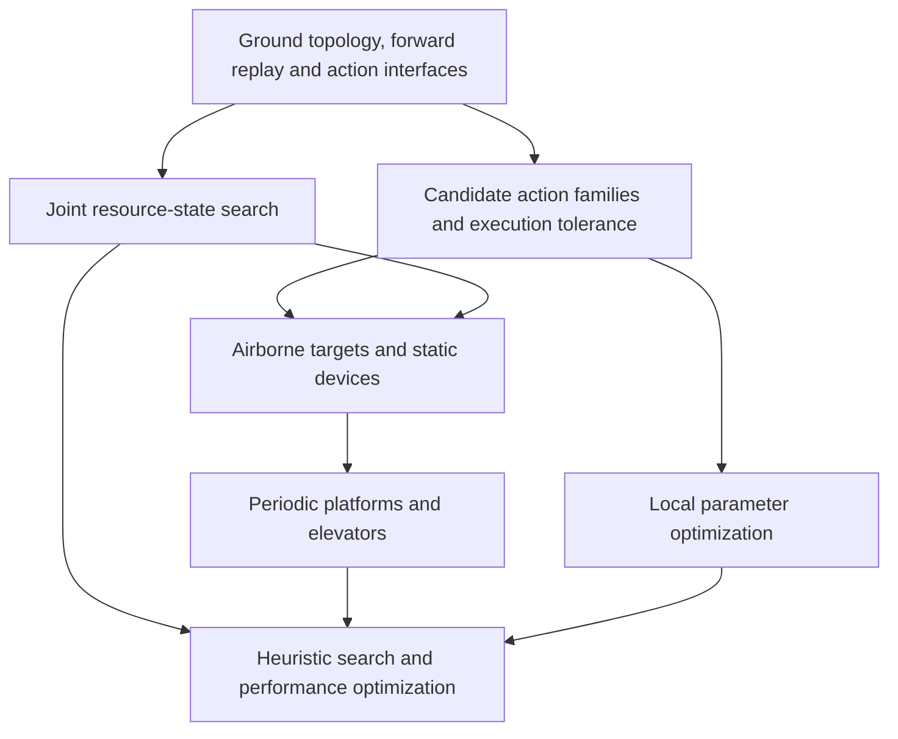

# Ganglia roadmap for executable paths and dynamic action planning

Version date 2026-11-04. The code baseline is Terra-Online/Ganglia `0.1.0-alpha.21`, commit
[`3a32a5d2f0df355107dcf94f5ed13fd9ae7b69a7`](https://github.com/Terra-Online/Ganglia/commit/3a32a5d2f0df355107dcf94f5ed13fd9ae7b69a7).
This document concerns navigation routes that human players can follow and execute. It covers
ordinary ground movement, jumping and falling, airborne targets, ziplines, bounce devices, periodic
moving platforms, elevators with selectable floors, and joint allocation of sprint stamina.

## Core decisions

For the current implementation milestone and measured computational costs, see
[solver reuse and performance](solver-performance.md). The phases below remain
acceptance requirements; isolated device or performance improvements do not imply
that their prerequisite phases have been completed.

Ganglia's next stage should optimize for completing a task as quickly as possible under explicit
execution-tolerance requirements. The width of a path family is useful, but the quantity to evaluate
is the domain of successful execution parameters. Counts of spatial curves or landing-position
variance provide different information. The main search should continue to use a hierarchical action
graph and multi-label resource-state search, with action generation and validation sharing a
movement model that supports forward replay. Local stochastic optimization and learning methods can
provide later enhancements.

The immediate modeling priority includes layered ground support and directed passages for stairs,
ramps and curbs. The [ground topology supplement](ground-topology.md) records a reproducible
staircase false negative, the supplied Atlos case and G0–G5 acceptance gates. Ground connectivity
needs stage-specific diagnosis and local refinement before broad airborne feasibility discovery.

Alongside this foundation, establish a forward-propagation interface for `entryState + controls →
actualExitState`, together with candidate generation that retains slightly slower, more forgiving
action families. The current analytic trajectories, body sweeps and spatial indices can be retained.
Moving stamina, gait and necessary velocity into graph search before extending airborne events,
device states and time-dependent connections can prevent repeated
system-wide repairs whenever another movement mode is added.

The near-term default should retain both a fastest route and a recommended route. The fastest route
provides a nominal-time comparison. The recommended route must pass predefined execution-margin and
perturbation-validation thresholds, with some additional travel time allowed. If the current budget
cannot establish a qualifying solution, the result should report the verified scope and remaining
gaps. A single nominally feasible execution is insufficient evidence of robustness.

## Implementation facts that affect the roadmap

### Trajectory generation and execution-error replay remain coupled

[`jumpConnection`](https://github.com/Terra-Online/Ganglia/blob/3a32a5d2f0df355107dcf94f5ed13fd9ae7b69a7/src/jumps.ts)
constructs a horizontal trajectory from specified endpoints and the vertical-motion duration, using
the specified `end` for the final sample.
[`sampleJourney`](https://github.com/Terra-Online/Ganglia/blob/3a32a5d2f0df355107dcf94f5ed13fd9ae7b69a7/src/motion.ts)
interpolates existing points and times for playback. Forward physical propagation from control
inputs requires a separate interface. Calling `jumpConnection(start', end)` after perturbing the
start readjusts the action for that start, so this procedure cannot measure the tolerance of a fixed
execution.

In obstacle-free diagnostic calls, starts at `[0,0,0]`, `[0.2,0,0]` and `[0,0,0.2]` all produced
trajectories ending exactly at the same target `[5,0,0]`, with intermediate motion also changing
with the start. This confirms that the generator re-aims. It provides no evidence that actual
perturbed executions share a landing point. The existing generator remains suitable for nominal
candidates, provided that candidates expose action parameters that can be saved and replayed.

### Retention currently favors witnesses that a connection exists

Region-pair validation in
[`traversal.mjs`](https://github.com/Terra-Online/Ganglia/blob/3a32a5d2f0df355107dcf94f5ed13fd9ae7b69a7/src/traversal.ts)
returns when it finds a feasible arc, and validated region pairs receive no further systematic
comparison of other actions.
[`shortcuts.mjs`](https://github.com/Terra-Online/Ganglia/blob/3a32a5d2f0df355107dcf94f5ed13fd9ae7b69a7/src/shortcuts.ts)
also uses the spatial cells of the start and end as an acceptance key. Once one action succeeds, it
skips other candidates for that cell pair. Existing diversity budgets help discover connections, but
are insufficient to estimate the successful domain around one execution.

These mechanisms alone do not establish the cause of any particular difficult result. They do show
that later evaluation may never see more forgiving candidates. Retention needs to consider
movement-mode sequences, entry states, takeoff and landing regions, and corridor topology together,
preserving representatives with different speed and execution-margin tradeoffs. Repeated sampling of
the same small successful region must not improve its robustness rating.

### The current objective accepts only faster routes

`shortcuts.mjs` bounds candidates by the baseline's actual travel time and prunes a candidate when
its time lower bound cannot improve that value.
[`planJumpRoute`](https://github.com/Terra-Online/Ganglia/blob/3a32a5d2f0df355107dcf94f5ed13fd9ae7b69a7/src/jump-planner.ts)
also updates the incumbent only for a complete result with shorter actual duration. Adding a
difficulty score only to the final result would therefore miss slightly slower, more forgiving
routes already excluded during generation.

Generation budgets, candidate retention, pruning and final comparison need coordinated changes. The
default recommendation may use an explicit additional-time budget relative to a currently known
feasible route. The unknown continuous global optimum provides no justified reference for that
budget. Maintain separate incumbents for robustness-qualified routes and nominally fastest routes.
The nominal incumbent is an invalid feasible upper bound for a search whose required feasible set
includes robustness constraints.

### Resource scheduling and route selection remain separate

[`routes.mjs`](https://github.com/Terra-Online/Ganglia/blob/3a32a5d2f0df355107dcf94f5ed13fd9ae7b69a7/src/routes.ts)
retains the lowest static cost per node, and
[`ground.mjs`](https://github.com/Terra-Online/Ganglia/blob/3a32a5d2f0df355107dcf94f5ed13fd9ae7b69a7/src/ground.ts)
invokes resource scheduling after selecting a route. In an earlier synthetic check, an ordinary jump
produced a feasible route lasting 6 seconds. Adding a faster connection whose sprint-entry condition
was unsatisfiable made the ground planner return `no-verified-route`. This demonstrates the need to
retain feasible alternatives within resource-state search, instead of filtering selected results
only at the end.

[`retimeGroundRoute`](https://github.com/Terra-Online/Ganglia/blob/3a32a5d2f0df355107dcf94f5ed13fd9ae7b69a7/src/locomotion.ts)
already retains labels for stamina, recovery delay, gait, velocity and direction. Its
resource-transition ideas are reusable. Its main decision, however, is whether each continuous
ground run permits automatic sprinting. Arbitrary activation, stopping and waiting policies remain
outside its coverage. The current `sprint` refers to ground sprinting. Airborne dash counts,
cooldowns and velocity changes require separate rules.

### Special actions already have a basic representation

[`GroundConnection` and
`MovementMode`](https://github.com/Terra-Online/Ganglia/blob/3a32a5d2f0df355107dcf94f5ed13fd9ae7b69a7/src/index-types.ts)
already support explicit `rope` and `launch` connections with direction, trajectories and timing.
Complete zipline or bounce-device import and control semantics still require additional work.
Current high-level connections require ground-projected endpoints, use fixed world-space
trajectories, and express time relative to segment entry. Missing semantics include interaction
regions, entry and exit conditions, device states, exit velocity and dynamic support.

[`createGoalProjector`](https://github.com/Terra-Online/Ganglia/blob/3a32a5d2f0df355107dcf94f5ed13fd9ae7b69a7/src/goals.ts)
still returns ground standing points for interaction goals. Passing through an airborne pickup
volume, continuing to land after a hit, and leaving a bounce device in an airborne state require
separate event and task states. The current prepared planner assumes an immutable scene snapshot.
Moving-platform phase and elevator control introduce world-state changes beyond that assumption.

## Evaluating actions that humans can execute easily

### Separate successful execution domains from spatial trajectory spread

Represent an action's parameters by θ, including takeoff position, entry velocity, heading, jump
timing, sprint timing and necessary durations. Fix the action sequence, landing region and corridor
topology first, then evaluate which nearby θ values still succeed. Normalize positions, angles and
times by meaningful error scales for each quantity. Centimeters, degrees and milliseconds cannot be
combined directly into one Euclidean distance.

The weighted volume of the successful domain expresses how many nearby executions remain feasible.
Its narrowest direction indicates whether any operation requires very precise timing or positioning.
A domain that is broad in position but extremely narrow in sprint timing is still difficult to
execute. Candidate counts depend on sampling density, convex hulls may span failure holes, and
average curves from different paths may collide with walls. In practice, choose a validated
representative in the interior of the successful domain and perform independent replay validation.

Three widths need separate interpretation. A broad allowed execution domain is generally helpful. A
broad traversable spatial corridor is generally helpful. A broad spread of actual trajectories
caused by errors can be harmful. Executions that all fall into the same failure location may have
low variance, while safe landings at different positions on a wide platform may have high variance.
Endpoint variance is therefore an auxiliary statistic. Primary criteria must include complete task
success, failure consequences, critical execution windows and compatibility between successive
actions.

### Specify error and feedback models

An initial version can use an interpretable execution pattern. Settle within a marked ground region
and align, jump while holding a specified direction, trigger subsequent actions near observable
events, and realign after landing. Perturb entry position, velocity, persistent directional bias,
reaction delay and button timing, with necessary physical-parameter uncertainty. Keyboard-and-mouse,
controller and touchscreen errors may have different structures. A common Gaussian model requires
evidence before it can represent all players.

Each replay must fix the nominal controls or a predefined limited-feedback policy. Re-optimizing the
entire action sequence for every perturbed scenario would invalidate the evaluation, as would
automatically restoring an ideal landing after every jump. Actual landing position, velocity,
stamina and time must enter the next segment. If the player can settle and realign, include that
process and its duration explicitly. Waiting and observation under unknown platform phase must also
be represented as real steps.

[Funnel Libraries](https://arxiv.org/html/1601.04037v3) provides a theoretical reference for
composing entry-state regions, disturbance propagation and exit regions. Its guarantees depend on
the specified feedback controller and disturbance bounds. Ganglia can adopt the interface concept,
while treating finite sampled success as a different evidence level from a rigorous funnel
certificate over continuous state space. In particular, actions that are individually robust from
ideal states can compose only when the actual output of the first falls within the allowed entry set
of the second.

### Two-stage evaluation and independent validation

The cheap stage should check standing-region width, landing-edge margin, lateral and overhead
obstacle clearance, run-up room, entry direction, sharp-turn requirements, critical button windows
and control-switch counts. Use it to filter clearly unforgiving candidates while retaining action
families with different tradeoffs. Real human success probabilities require additional evidence.
Recheck action preconditions and related evidence when ground straightening or resource retiming
changes entry direction or velocity.

The expensive stage should replay perturbations only for competitive candidates and complete routes.
Record completion, actual duration, failure causes, recoverability, exit velocity and remaining
resources. Errors should include both local jitter and persistent biases. Joint multivariable
perturbations require coverage beyond one-dimensional scans. Dynamics randomization should use
evidence-based ranges. Arbitrarily large noise cannot compensate for a missing model.

Keep search perturbations separate from final acceptance samples. Ordinary binomial confidence
intervals require assumptions such as independent and identically distributed acceptance trials. A
small all-success sample provides limited evidence. As a statistical illustration, for one fixed
route with 100 independent and identically distributed trials and no failures, the exact one-sided
95% lower confidence bound on success probability is about 97.0%. The sample does not establish 100%
reliability. This conclusion applies only to the selected perturbation distribution. Real player
completion rates require separate calibration. See [NIST exact binomial confidence
limits](https://www.itl.nist.gov/div898/software/dataplot/refman2/auxillar/exacbici.htm) for the
interval method.

### Objectives and risk composition

An interpretable near-term policy first satisfies minimum execution-window and simulated-success
thresholds, then minimizes time among qualifying solutions. An alternative selects the most
forgiving solution within an explicit additional-time budget. Store physical duration, ranking cost
and risk information separately. A difficulty penalty added to `route.cost` would make that value
unsuitable as physical seconds or playback duration.

Failing onto nearby safe ground has different consequences from having to repeat a long approach.
Recovery cost can later enter completion-time estimates, with tail-loss measures accounting for rare
severe failures.
[Rockafellar–Uryasev](https://sites.math.washington.edu/~rtr/papers/rtr179-CVaR1.pdf) gives the
basic CVaR definition. Probability thresholds limit failure frequency, while tail costs distinguish
severity. Both require explicit error and recovery models.

Multiplying edge success rates measured from ideal entries is insufficient to establish
complete-route success probability. A valid chain-rule decomposition depends on the conditional
entry distribution produced by preceding successful actions. Persistent directional, stamina and
phase errors may also correlate across segments. Initially, a cheap execution-difficulty proxy can
guide search, followed by complete-route replay. Strict in-search risk budgets would require
conditional risk bounds valid over entry sets or explicit uncertainty propagation.

## Candidate generation and search strategy

Action generation should retain families under finite budgets. Each family should at least bind an
entry support surface, movement-mode sequence, exit region and required velocity/resource
conditions. Retain nominally fastest, largest empirical margin, lower-resource and directionally
distinct representatives. Apply local perturbations and progressive refinement around similar
actions instead of uniformly increasing map-wide resolution. Preserve diversity across topological
routes so that K shortest paths capture meaningful alternatives beyond small variations of one
difficult route.

Establish a correctness baseline with multi-label Dijkstra at h=0 before adding A*. Each label
carries movement and resource information that affects subsequent reachability. States at the same
position with different velocities, stamina or device states require justified merging conditions.
Dominance pruning must preserve substitutability for all continuations. Earlier arrival alone is
insufficient. Finite label truncation may remain, with explicit diagnostics and optimality claims
limited to the conditions actually satisfied.

Prefer provable time lower bounds, such as horizontal distance divided by an upper bound on
horizontal speed across all allowed actions, or an optimistic abstract graph containing every
necessary action. Ground-only distance may overestimate jump or device shortcuts. An obstacle-free
model that removes platforms while also preventing landing and reset may accidentally make the task
harder. The maximum of valid lower bounds remains useful, while arbitrary sums require proof.
Learned predictions can initially guide ordering or budget allocation. Admissibility requires
separate justification.

When an early result followed by continued improvement is needed, Weighted A* or
[ARA*](https://papers.neurips.cc/paper_files/paper/2003/file/ee8fe9093fbbb687bef15a38facc44d2-Paper.pdf)
can operate on the correct state graph. Their guarantees apply only to search graphs and objectives
satisfying the relevant conditions. Dynamic candidate-edge additions, changed risk decisions or
corrected resource costs require appropriate search repair or restart. Existing spatial hierarchies,
standing-check caches and geometry validation remain reusable. Measure candidate generation,
collision validation, resource-label expansion and final perturbation validation separately before
optimizing.

## Tradeoffs among ant colony and other stochastic optimizers

Given a search representation and scoring function, ant colony optimization can seek useful
combinations through repeated sampling and pheromone updates. The original ACS constructs graph
paths with artificial ants and reinforces edges according to results. See the [original paper by
Dorigo and Gambardella](https://doi.org/10.1109/4235.585892). These algorithm-generated visit counts
provide no direct measurement of human comfort or execution tolerance.

For the current single-source, single-goal problem with an existing action graph and computable
costs, I recommend retaining the main global search before considering ACO. A nominal-time reward
can reinforce narrow, extremely fast solutions. Adding robust evaluation still incurs full
simulation and validation costs, together with repeated stochastic search and parameter tuning. ACO
could later serve as a comparison for multi-target visit ordering, regional tours or complex
combinatorial tasks. The present gaps concern state, device semantics and error models.

For local continuous parameters, I would first try CEM. Fix the action family and approximate
corridor, sample a few variables such as takeoff position, direction and sprint timing, then retain
better samples under the robust objective and update the sampling distribution. CEM planning in PETS
offers a reference in [Chua et al.
2018](https://papers.neurips.cc/paper/7725-deep-reinforcement-learning-in-a-handful-of-trials-using-probabilistic-dynamics-models.pdf).
The optimizer can be reused with the existing dynamics model. Use multiple starts or retain multiple
clusters to avoid premature collapse onto one narrow solution, followed by independent validation.

MPPI suits receding-horizon control with real-time state input, using parallel control-sequence
samples to improve actions. See the [original paper by Williams et
al.](https://arxiv.org/abs/1509.01149). For human-executable route guidance, perfect frame-by-frame
correction would overestimate player capability. Its near-term priority is therefore below
low-dimensional action optimization. It can serve as a restricted local-control baseline when
observations, reaction speed and control changes are constrained to match the intended use.

## Lessons from game navigation engines

Recast's `walkableRadius` erodes walkable space away from obstacles to accommodate the body.
Detour's `dtPathCorridor` stores a polygon corridor and supports updates after positional deviations
and local optimization. Ganglia can adopt a corridor representation that retains width. Body-radius
clearance establishes hard feasibility, while additional human execution margins and centering
preferences require their own treatment. Simply increasing the radius cannot replace all robustness
validation. See the official [rcConfig](https://recastnav.com/structrcConfig.html) and
[dtPathCorridor](https://recastnav.com/classdtPathCorridor.html) references.

Unity's NavMeshLink supports entrance edges with width, directionality and cost overrides, offering
a useful reference for action-family entry regions. Its area costs multiply distance and express
navigation preferences, with a separate interpretation from travel seconds. Unreal Smart Links
delegate special actions to custom logic, then resume ordinary path following. These public
interfaces show the division between global navigation and special-action execution. Player success
probabilities, cross-action stamina allocation and full elevator scheduling require additional
models. See [Unity
NavMeshLink](https://docs.unity3d.com/Packages/com.unity.ai.navigation@2.0/manual/NavMeshLink.html),
[Areas and
Costs](https://docs.unity3d.com/Packages/com.unity.ai.navigation@2.0/manual/AreasAndCosts.html) and
[Unreal
ANavLinkProxy](https://dev.epicgames.com/documentation/en-us/unreal-engine/API/Runtime/AIModule/ANavLinkProxy).

The current `straighten.mjs` performs line-of-sight straightening under support and wall
constraints. Human execution tolerance remains a separate evaluation. It can keep removing redundant
bends while preserving necessary entry regions and directional conditions near takeoff preparation,
post-landing turns and risky edges. Extra `clearance` inflates the body in every direction and may
intersect legal ground support. Evaluate legal contact, lateral obstacle distance and execution
perturbations separately.

## Modeling special targets and devices

### Airborne destinations

The goal interface should distinguish standing ground interaction, trajectory contact, and safe
termination after contact. Airborne targets require continuous trajectory-intersection events with
the pickup volume, including ascending motion and fast crossings. Checking trajectory samples or
landing positions alone is insufficient. If safe landing is required after a hit, carry `goalHit`
through continued search. If collection changes resources or movement capabilities, represent that
change as an event transition.

Airborne states must retain actual velocity, movement mode and resources as well as position. Device
launches, mid-zipline releases and jumps from moving platforms can all feed the same airborne
propagator. The query interface should explicitly state whether airborne initial states are allowed.
Automatically projecting them to ground would change the original problem.

### Static ziplines and bounce devices

For static ziplines, first implement the complete approach, grab, ride and exit sequence. Add entry
volumes, heading or interaction requirements, startup overhead, availability and exit velocity.
Fixed-endpoint versions can reuse existing `rope` connections before dynamic platforms are
available. Mid-ride release requires an attached state and release event, with actual exit velocity
passed to the airborne propagator. Editing the endpoint of a fixed polyline alone is insufficient.

Bounce devices should supply a launch initial state, including initial velocity, entry-velocity
inheritance, permitted air control and resource-reset behavior. Their rules may differ from ordinary
character jumps and require an explicitly chosen model beyond a shared `maxJumpHeight`. A fixed
trajectory through complete landing can first enter as a `launch` macro-action. Continuous airborne
decisions after launch must also allow an airborne output state.

### Platforms following fixed back-and-forth paths

Platforms should expose time-dependent poses, standing regions, docking and boarding windows, and
stable device IDs. Once boarded, express character position in platform-local coordinates and
transform it into world space at the current time. A moving platform provides support and also
constitutes dynamic collision geometry. Boarding, riding and departure require relative-velocity,
full-body-clearance and legal-contact checks. Velocity inheritance at takeoff must follow the game's
rules.

The first version should prioritize boarding and departure at stops and safe waiting, then extend to
boarding or jumping off in motion and transfers between platforms. Reuse the static-terrain BVH
while giving dynamic objects separate time-dependent queries and continuous-motion bounds.
Rebuilding the entire NavMesh every frame is unnecessary. Endpoint-only checks cannot establish
clearance from ceilings or obstacles throughout a ride.

For known phase, an edge's cost includes waiting after arrival, boarding, riding and exiting, with
resource progression in every stage. FIFO in time-dependent shortest paths requires the arrival-time
function to be nondecreasing in departure time. A fixed platform period alone does not establish
this property. If waiting is freely available at a safe point and cannot affect the device's future
motion, choosing an appropriate later service can form a waiting envelope. Resources and velocity
may still require multiple labels. See [Dean's paper on FIFO time-dependent
networks](https://people.csail.mit.edu/bdean/tdsp.pdf).

[SIPP](https://www.cs.cmu.edu/~maxim/files/sipp_icra11.pdf) offers safe intervals to compress time,
initially useful for states that can settle and wait. Original SIPP depends on assumptions such as
instantaneous stopping. Direct use with acceleration or deceleration constraints may be incomplete,
as discussed in [SIPP-IP](https://arxiv.org/abs/2302.00776). Airborne motion and transfers with
entry velocity still require their corresponding dynamic states. Safe intervals alone cannot replace
them.

If OEM lacks synchronized game time or platform phase, the default output should use conditional
steps such as boarding after the platform docks, with waiting ranges derived from known operating
rules. Expected waiting time requires a specified phase distribution. Neither half-period waiting
nor a platform already at the stop is a justified default. Refine the plan into a timed trajectory
after receiving reliable phase information, and evaluate whether arrival-time errors can make the
player miss a window.

### Elevators with selectable floors

Calling an elevator and selecting a floor alter its future. Model a small device state machine
containing its current floor or movement phase, door state, destination floor and relevant
permissions. Character actions include calling, waiting, entering, selecting a floor, riding and
exiting. Device-state changes belong to the joint search state. Compress the full process into a
conditional macro-action only when other requests are known to be absent and behavior is
predictable.

Keep the exogenous time process of periodic platforms distinct from controllable elevator
transitions. With incomplete information, such as other players' requests or an unobserved elevator
location, output conditional actions or conservative waiting ranges instead of unsupported precise
ETAs. Bound the combinatorial state by expanding only devices relevant to the candidate route, and
state the single-player or known-request assumptions explicitly.

### Making full use of sprint stamina

Optimize completion time subject to execution-reliability requirements. Resource consumption has no
separate reward. If the goal permits zero remaining stamina, an artificial reserve is unnecessary.
Constraints must still account for resources needed by the next jump, boarding action or failure
recovery. In particular, use unavoidable rides, interactions and waits for recovery, comparing the
full consequences of catching the current platform service against moving more slowly to recover
before the next one.

Define resource transitions by action mode. A single `recoveryDuringNonWalk` boolean is insufficient
as a long-term model for every situation. Gradually refine activation, stopping and recovery within
continuous ground runs. Initially generate decisions at events such as stamina thresholds, the end
of recovery delay, turns, device entrances and time windows, adding finer continuous-time decisions
as needed. Event-based decisions require their own completeness analysis. Retain diagnostics for
finite waiting and execution windows, while avoiding large collections of per-frame waiting states
or pointless activation-stop oscillation.

## A suitable role for reinforcement learning

The most promising initial uses of reinforcement learning are local skills, candidate ranking and
feasibility prediction. Skills might include jumping to a wide platform, adjusting a device launch
toward a landing region, or boarding within a visible window. A higher level continues to choose
target regions, resources and device actions. Training requires an environment with repeatable
resets, forward progression and success evaluation. It therefore depends on the unified propagator
and requires an explicit model of the game's rules.

Rewarding speed alone encourages greater reliance on precise operations. Human route guidance should
constrain reaction delay, action frequency, observable information and control switching, with
imitation objectives when appropriate demonstrations exist.
[DeepMimic](https://xbpeng.github.io/projects/DeepMimic/index.html) demonstrates skill learning that
combines demonstrations and task objectives. A learned executable controller still needs separate
evaluation of whether a player can reproduce its behavior from route guidance.

Randomizing dynamics, input delay and observation errors can improve robustness. See the empirical
work in [Peng et al. 2018](https://xbpeng.github.io/projects/SimToReal/SimToReal_2018.pdf). Those
results concern specific robotic tasks and do not establish reliable transfer from an uncalibrated
game simulation. For Ganglia, learned candidate ordering and validation-budget allocation, with
forward propagation and collision checks retaining final authority, offer more measurable benefits
and clearer detection of model exploitation.

## Phased development roadmap

### P0 Establish ground topology, action replay and evidence

Complete the ground supplement's G0–G2 reference milestone. Specify layered support and directed
ground-controller passages, retain native topology alongside detail heights, and validate local
refinement on staircase families and obstructed controls. Search, reconstruction, straightening and
action-boundary discovery must consume the same passage authorization. Trace missing ground links
to their source or build stage before expanding candidate budgets.

Retain analytic generation in `jumps.mjs`, adding persistable control parameters and a validator
that propagates a complete entry state forward to the actual exit state. Carry controls, entry/exit
state, legal contacts, support or device references, goal events and model versions through types,
graph edges, `routeSegment` and result output. Current conversions forward fixed properties, so
additional data on temporary candidates requires explicit propagation through the pipeline.

Acceptance requires nominal inputs to reproduce the original trajectory within an interpretable
precision, perturbed inputs to propagate without hidden re-aiming, successive segments to consume
actual exit states, and identical inputs and seeds to reproduce results. Store fixed scenes
representing real execution difficulties alongside basic movement and collision fixtures. Define
comparison semantics for the recommended objective, fastest results and robust results at the same
time, providing shared interfaces for subsequent modules.

### P1 Address difficult executions directly

Change single-witness retention in `traversal.mjs` and `shortcuts.mjs` to retain multiple
representatives per action family, with an explicit budget for slightly slower candidates. Apply
cheap margin filtering before forward perturbation replay of the most competitive actions and
complete routes. Update incumbent comparison in `jump-planner.mjs` to admit the intended
robustness/time tradeoffs, and recheck action conditions after `straighten.mjs` and retiming.

Acceptance scenes should contain both a fast, narrow route and a slightly slower, wider route.
Recommended mode should select the latter while fastest mode retains the former. Duplicate
candidates must leave the successful-domain rating unchanged. Reject actions whose perturbations all
fail despite low landing variance. Preserve safe, diverse landings on wide platforms without
penalizing variance alone. Showing takeoff regions, acceptable headings and observable trigger
events provides more useful execution guidance than an extremely thin centerline alone.

### P2 Incorporate resources and action conditions into graph search

Prioritize the boundaries among `routes.mjs`, `ground.mjs` and `locomotion.mjs`, advancing stamina,
recovery delay, gait and necessary velocity on every edge expansion. Start with multi-label Dijkstra
as an inspectable baseline, then add valid lower bounds. Reserve interfaces for waiting, world time
and device state, while enabling only necessary dimensions in static queries. Dominance requires
equivalent continuation capabilities, with explicit label budgets and truncation.

Retain the reproduced 6-second feasible-route regression. Adding an unusable fast edge must preserve
the feasible alternative. Add cases requiring resource reserves between jumps, competing sprint
activations on short and long ground runs, and recovery waits before further movement. P1 and P2 can
proceed in parallel after their common interface is established, allowing execution-quality
improvements before a complete resource optimizer is available.

### P3 Add airborne events and static devices

First complete fixed-zipline and fixed-bounce-device import and semantics, reusing existing `rope`
and `launch` display, timing and graph connections. Then distinguish standing interaction, airborne
contact and safe termination after contact, allowing device exits to enter airborne states. Mid-ride
release, continuous airborne controls and other complex device behavior can follow once the basic
rules are explicit.

Acceptance should cover targets reachable only while ascending, high-speed crossings of small
targets between samples, hazardous falls after contact, and device startup and exit overhead. Also
verify zipline direction, entry volumes, locked states, launch velocity and final resources. A
device marker alone provides insufficient evidence of a valid connection. Continuous target events
and collision checks should share a compatible time model. Contact by an inflated envelope alone
cannot establish a real hit.

### P4 Add time-dependent moving platforms and controllable elevators

Begin with one platform of known phase and fixed operating rules, supporting platform-local
character coordinates and wait, board, ride and exit actions. Then add conditional navigation under
unknown phase, transfers among platforms and selectable-floor elevators. Compress waiting states
through time windows or safe intervals, while retaining necessary state for airborne and
entry-velocity-dependent actions.

Vary departure phase in acceptance tests to check safe early waiting, missed-window waits for the
next cycle, excessive relative velocity preventing boarding, insufficient overhead clearance during
rides, and exit velocity and resources. Elevator tests should cover an elevator at another floor,
calls and door opening, floor selections changing future motion, and unavailable devices. Compare
complete routes that catch the current service with those that move more slowly to recover and take
the next one, ensuring time and resources jointly affect decisions.

### P5 Refine action parameters and stamina allocation

Once candidate families and forward validation are stable, use CEM or constrained local search to
adjust takeoff position, entry direction and sprint timing. Refine continuous-ground sprint
allocation from whole-run switches toward critical events and local continuous optimization,
accounting for recovery during unavoidable waits or rides. Frequent control changes and tiny
execution windows remain constrained by the human execution model.

Acceptance should compare complete perturbed executions and actual duration before and after
optimization. Nominal time reduction alone is insufficient. Resource exhaustion earns no intrinsic
reward. An improvement must provide faster, executable completion. Validate top candidates with
independent seeds and independent scenes to detect overfitting to one perturbation sample set.

### P6 Optimize system performance and decide on learning investment

Use measured metrics to decide whether to introduce ARA*, stronger abstract heuristics, incremental
replanning or finer local generation. Distinguish static-geometry evidence from state-dependent
movement/robustness evidence in caches. Entry velocity, resources, platform phase, device mode, goal
semantics, control policy and error configuration define applicability conditions. Background
progressive validation and interruptible budgets should retain completed routes and represent
unfinished searches explicitly.

The first learning experiment should rank candidates or implement one local skill, compared against
multi-label search plus local optimization under the same budget. Evaluate broader hierarchical RL
only after the forward model, sample data and scene benchmarks stabilize. ACO can remain an
experimental option for later multi-target ordering, with the current main architecture retained.

## Acceptance and decision metrics

Record nominal duration, actual duration under perturbations, whole-task success rates and
intervals, severe and recoverable failure proportions, critical execution windows and actual
remaining resources. Resource metrics explain time allocation and carry no separate consumption
reward. Until calibrated against real players, label results as simulations under the specified
error model.

Separate time to first feasible result, time to first recommendation-qualified result, final quality
at budget exhaustion, and costs of generation, body sweeps, label expansion and perturbation replay.
Compare algorithms under fixed scenes, hardware and query budgets, reporting high-percentile latency
and truncation rates. The same metrics must expose increased candidate success at the expense of
coverage, or greater robustness accompanied by widespread query timeouts.

Regression scenes should cover narrow takeoff regions, diagonal landings, jumps after sharp turns,
low ceilings, diverse safe landings on wide platforms, accumulated multi-jump errors, competing
resource needs between jumps, jumps after zipline exits, ascending airborne targets, missed platform
services and elevator floor selection. Synthetic scenes isolate algorithm behavior, while real game
scenes calibrate the model. Update route documentation and API descriptions as capabilities change,
keeping older limitations in `docs/route-preview.md` in their historical context.

The most valuable next deliverable is an evaluation build that displays the nominally fastest route,
recommended route, takeoff execution region and perturbation replay results in the same scene. It
directly tests whether the new objective addresses the current difficult executions and provides a
common standard for resource search, special devices and later learning experiments.
